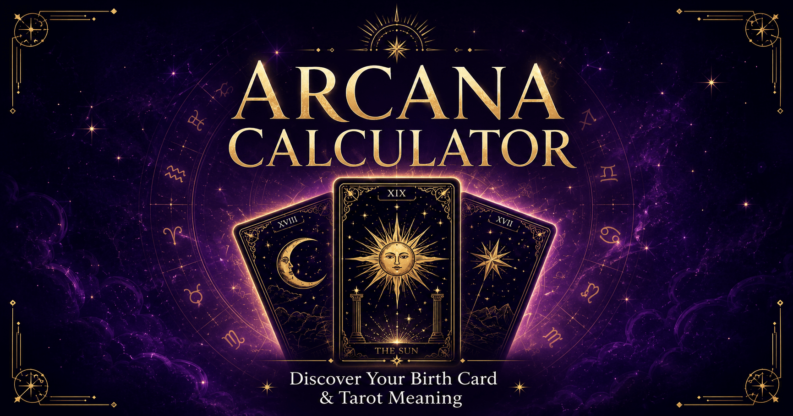
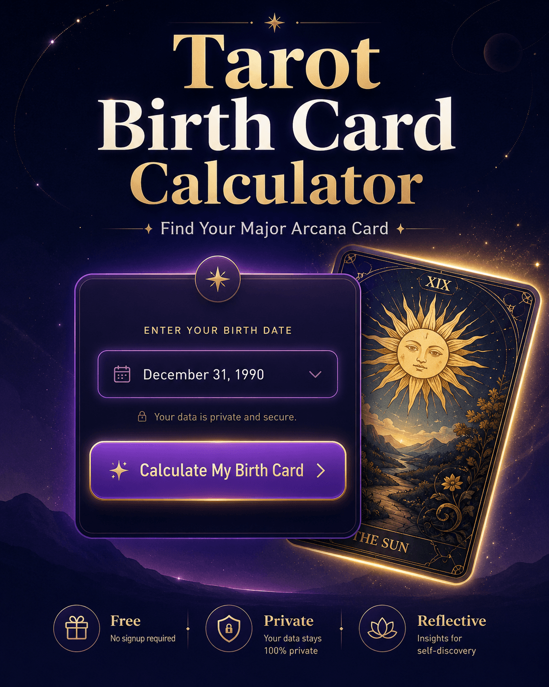
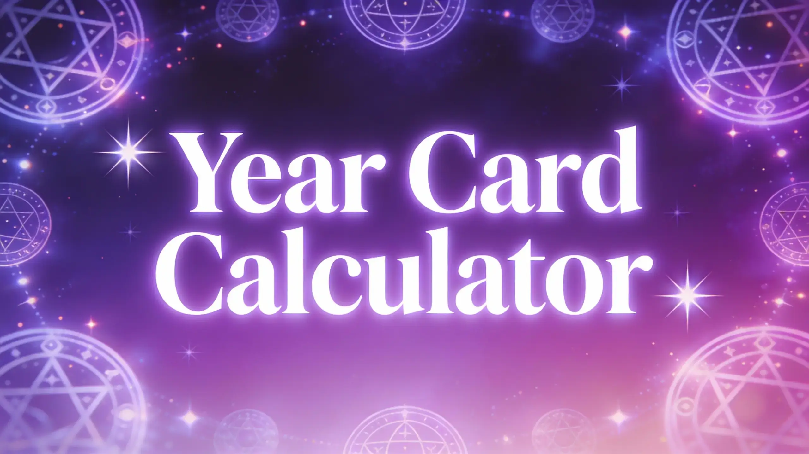

# Arcana Calculator

Open formulas for the [Arcana Calculator](https://arcanacalculator.com): a tarot birth card from your date of birth, a major-arcana year card for any calendar year, and a life path number that keeps the master numbers 11, 22, and 33.

[](https://arcanacalculator.com)

The website runs these calculations in the browser, in several languages, and shows the card. This repository is the arithmetic, so you can run the same numbers locally and check the result. Readings, accounts, and the site source are not included.

| Calculator | What it uses | Open it |
| --- | --- | --- |
| [Birth card](https://arcanacalculator.com/tarot-birth-card-calculator) | Every digit of `YYYYMMDD`, folded to the 22 major arcana | [Tarot birth card by date of birth](https://arcanacalculator.com/tarot-birth-card-calculator) |
| [Year card](https://arcanacalculator.com/year-card-calculator) | Birth month, birth day, and the digits of a target year | [Year card calculator](https://arcanacalculator.com/year-card-calculator) |
| [Life path](https://arcanacalculator.com/life-number-calculator) | Month, day, and year reduced separately, keeping 11, 22, and 33 | [Life number calculator](https://arcanacalculator.com/life-number-calculator) |

## Run the formulas

Requires Node.js 18 or newer.

```bash
node bin/arcana.mjs 1990-03-15 --year 2027
```

```text
Birth date: 1990-03-15
Birth card: 10 Wheel of Fortune (19900315 → 28 → 10)
Year card 2027: 7 The Chariot (3 + 15 + 11 = 29)
Personal year 2027: 2
Life path: 1 (month 3 + day 6 + year 1)
```

```bash
npm test
```

## Birth card

[](https://arcanacalculator.com/tarot-birth-card-calculator)

Add every digit of the birth date written as `YYYYMMDD`. While the total is above 22, replace it with the sum of its digits. A result of 22 is shown as **0, The Fool**.

March 15, 1990:

```text
1 + 9 + 9 + 0 + 0 + 3 + 1 + 5 = 28
2 + 8 = 10
```

10 is Wheel of Fortune.

July 18, 1996:

```text
1 + 9 + 9 + 6 + 0 + 7 + 1 + 8 = 41
4 + 1 = 5
```

5 is The Hierophant. January 29, 1900 sums to 22 and is shown as The Fool.

Check a date in the [birth card calculator](https://arcanacalculator.com/tarot-birth-card-calculator).

## Year card

[](https://arcanacalculator.com/year-card-calculator)

Add the birth month, the birth day, and the digits of the target year. The birth year is not used. Wrap the total onto the 22 cards with `((total - 1) % 22) + 1`. A wrapped 22 is shown as **0, The Fool**.

The personal year uses the same total, reduced until it is a single digit from 1 to 9. This reduction does not keep 11 or 22.

March 15, for 2027 (`2 + 0 + 2 + 7 = 11`):

```text
3 + 15 + 11 = 29
((29 - 1) % 22) + 1 = 7
```

7 is The Chariot. The personal year is `2 + 9 = 11`, then `1 + 1 = 2`.

This wrap is not the birth-card digit sum. A total of 23 is birth-card 5 (`2 + 3`) and year-card 1 (`((23 - 1) % 22) + 1`).

Check a year in the [year card calculator](https://arcanacalculator.com/year-card-calculator).

## Life path

[](https://arcanacalculator.com/life-number-calculator)

Reduce the month, the day, and the year separately. Keep 11, 22, and 33 when they appear. Add the three results and reduce that sum the same way.

March 15, 1990:

```text
month 3
day 15 → 6
year 1990 → 19 → 10 → 1
3 + 6 + 1 = 10 → 1
```

November 2, 1998 stays at master number 22: month 11, day 2, year `1 + 9 + 9 + 8 = 27 → 9`, then `11 + 2 + 9 = 22`.

November 11, 2009 is 33: month 11, day 11, year `2 + 0 + 0 + 9 = 11`, then `11 + 11 + 11 = 33`.

Check a date in the [life number calculator](https://arcanacalculator.com/life-number-calculator).

## Cards

`data/major-arcana.json` lists the 22 major arcana in Rider–Waite–Smith order: Strength is 8, Justice is 11. Each entry has a name and three short keywords. The keywords name the common theme of the card. They are not a reading.

## 中文说明

[Arcana Calculator](https://arcanacalculator.com) 用出生日期计算大阿卡纳出生牌、任意年份的年运牌，以及保留 11、22、33 的生命灵数。上面的图就是网站首页和三个计算器的页面。

- [出生牌计算器](https://arcanacalculator.com/tarot-birth-card-calculator)：把 `YYYYMMDD` 的每位数字相加，大于 22 就继续相加；得到 22 时显示为 0，愚者。
- [年运牌计算器](https://arcanacalculator.com/year-card-calculator)：出生月 + 出生日 + 目标年各位数字之和，再用 `((总数 - 1) % 22) + 1` 折进 22 张牌；22 显示为 0。个人年把同一个总数约成 1–9。
- [生命灵数计算器](https://arcanacalculator.com/life-number-calculator)：月、日、年分别约简，保留 11、22、33，三者相加后再约简一次。

本仓库只包含这三套算法、牌名和本地脚本。解读文案、账号和网站源码不在这里。

## License

[MIT](LICENSE)
